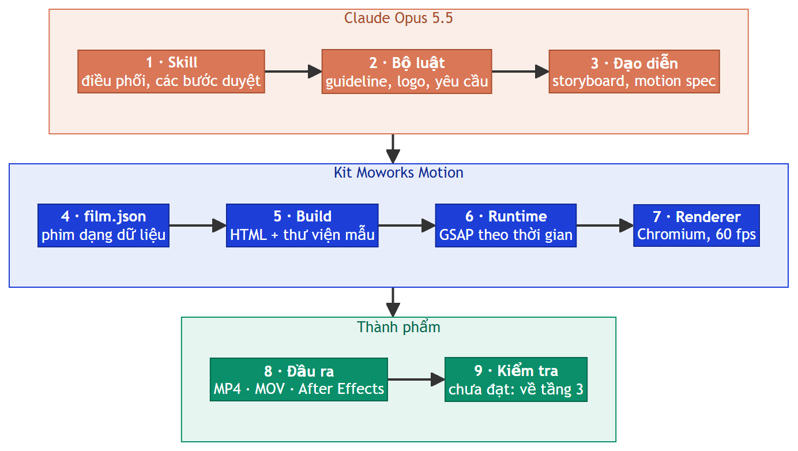
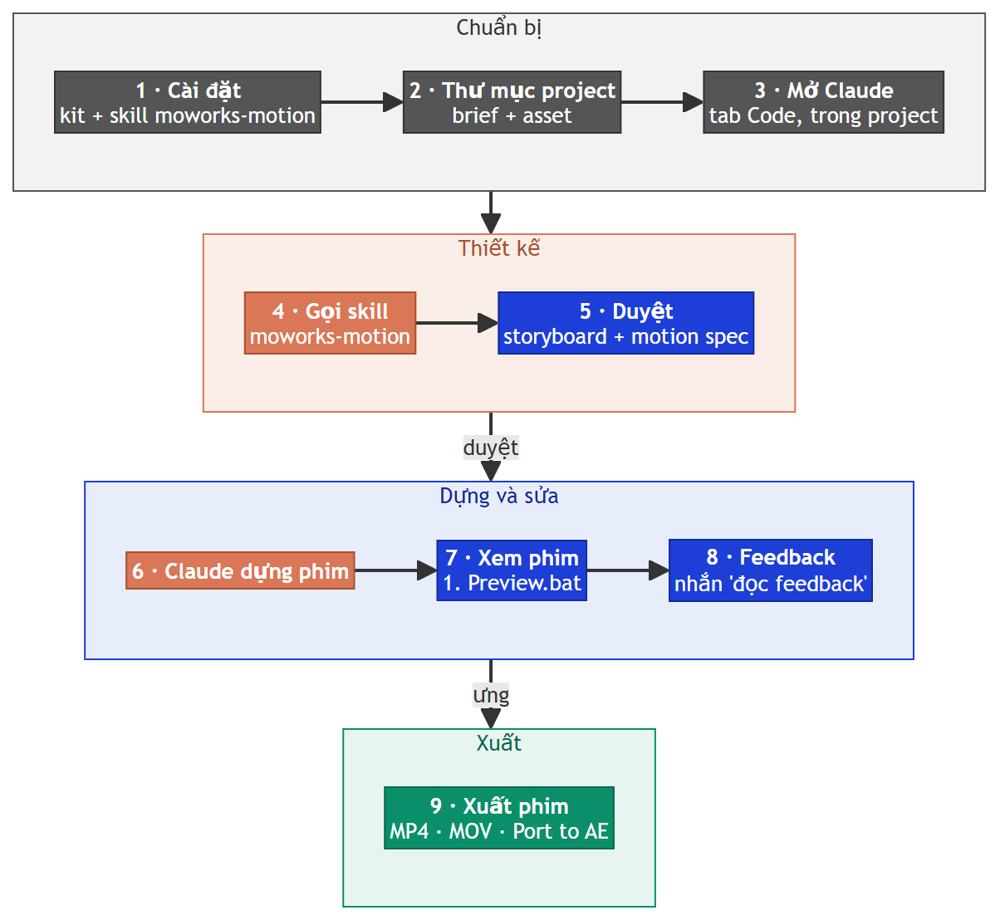

<h1 align="center">Moworks Motion</h1>

<p align="center"><a href="README.md">Tiếng Việt</a> · <b>English</b></p>

<p align="center"><b>From brief to motion graphics film: Claude directs, the kit builds every frame in code.</b></p>

<p align="center">
  
  
  
  
  
  
</p>

<p align="center">
  <a href="#quick-start">Quick start</a> ·
  <a href="#project-types">Project types</a> ·
  <a href="#features">Features</a> ·
  <a href="#common-commands">Commands</a> ·
  <a href="GUIDE.md">Guide (Vietnamese)</a> ·
  <a href="CHANGELOG.md">Changelog</a> ·
  <a href="KNOWN-ISSUES.md">Known issues</a>
</p>

Moworks Motion is a toolkit for making motion graphics videos with Claude. You provide the material: PSD files, decks, images, music,
reference videos or just a written description. Claude designs, presents each step for your approval, then builds the film in HTML +
GSAP. The kit renders at 60 fps, checks its own work and exports MP4, MOV or an editable After Effects project.

The kit has two parts: the kit folder (this repository) and the **moworks-motion** skill for Claude Code. `install.bat` installs both;
`update.bat` updates both. The detailed documentation is in Vietnamese.

## Why build films in code

- **Deterministic:** every frame is a function of time. The same input always gives the same frame, however many times you render.
- **Local edits:** change one scene, one line of text or one beat without touching the rest.
- **Edits in plain words:** "faster transitions", "change the music", "bring the words in with the lyrics" are changes Claude makes in
  minutes.
- **Runs on your machine:** films are built and rendered locally; guidelines and client material never leave the machine.

## Project types

| Input | Project type | Approval before building |
|---|---|---|
| Finished design for every frame (PSD / PSB, deck, PDF, images) | **Keep design:** layout, fonts and colours stay as designed (2 px tolerance); Claude only animates | Per-scene motion spec |
| Copy, ideas, a song, a guideline | **New design:** Claude designs layout, graphics and motion | 3 storyboard options, then the motion spec |
| A reference video | **Style remake:** learns the pacing, layout and motion language; the content is yours | Shot list read from the reference + conversion rules |

Films with characters or illustrations add one approval step: a sheet of characters, locations and props in every pose, before animation.

### Remake: follow the style, avoid 1:1 copies

The kit reads the reference video (cuts, pacing, layout, motion measured frame by frame) and builds a new film with your content, brand
and music. The recommended approach is a **style remake**: keep the spirit, rhythm and motion language of the reference while the design
is redone for the new content.

**A frame-by-frame 1:1 copy** (especially characters, animation and hand-drawn illustration) is heavy work: a film of about 30 seconds can
take many hours and several hundred US dollars (at API prices), and the result still cannot be identical. Claude states the time and cost
up front and proposes a lighter option before starting. Built graphics (type, shapes, interfaces, footage) can follow the reference more
closely when needed. Either way, a remake never reuses the people, voice, music or logos of the reference.



## Features

| Area | Description |
|---|---|
| **Input** | PSD / PSB, PowerPoint, Google Slides, PDF, images, music, voice-over, reference video, text; a GitHub pull request can also be the material of an explainer film |
| **Story first** | Message and story arc before design; one job per scene; the storyboard states why each scene exists; content appears with the voice-over |
| **Step-by-step approval** | Storyboard, motion spec, shot list (remake), character sheet: no motion is built before approval |
| **Brand** | Applies guidelines (fonts, type scale, colours, margins, logos) from locally stored brand packs, with automatic checks; logos are never distorted. Unbranded films use one of **13 built-in looks** |
| **Transcription** | Listens to voice-overs, songs or speech in video and writes down what is said with a timestamp for every word, plus `.srt` subtitles for editing software; runs locally with Whisper, Vietnamese and English. Word times place motion, sound effects and captions exactly when each word is spoken |
| **Music** | Beat detection (a kick check under 120 Hz, with a picture), aligns known lyrics to the singing, text on the lyric; 9 beat-synced cut templates; moves where the music starts so cuts land on the beat; **carve**: cuts only the voice's frequency bands out of the music instead of ducking the whole track |
| **Sound** | 19 recorded sound effects (whoosh, pop, click, key press, riser, impact…), each one's level measured: above the music, below the voice; the master at -16 LUFS with peaks under -4 dB, measured on the exported MP4 and in mono; a cue sheet of the frames before / after every sound and five moments to check with headphones |
| **Talking-head video** | 10 graphic card styles, automatic layouts (split, stacked, picture-in-picture, full frame); person cut-out so text sits behind the speaker; **35 caption styles** from HyperFrames run as shipped, with Vietnamese support |
| **Character films** | Shared character rig (proportions, hair, face, clothing, 20 poses, hands, expressions, lip sync, walk cycle); character sheet and joint checks before approval |
| **Remake** | Cut detection, shot list, motion measured on the reference frames (timing, distance, ease), music stretched to the original tempo, side-by-side comparison video |
| **anime.js** | All of anime.js 4.5 on the film's clock (frame-accurate seeking, export, After Effects port): text splitting, scramble, grid stagger, SVG morph, line drawing, motion paths, layout changes |
| **Quality checks** | Lints for reading time and text contrast, overlapping text, blank frames; onion skin, position / speed graphs; motion-spec numbers checked against the real film; sound effect levels measured on a phone speaker band |
| **Review player** | Timecoded notes, automatic reload when Claude edits, version history and comparison, smooth-playback mode for laptops |
| **Export** | MP4 H.264, MOV ProRes 4444 (alpha), Full HD or 4K, motion blur blended in linear light, GIF; 16:9, 9:16, 1:1, 4:5 and reframing an approved film to another format |
| **After Effects** | Editable layers and keyframes: real text layers (including text inside HyperFrames blocks), shape layers from SVG, track mattes, precomps, separate audio stems |
| **Presentation** | Turns a film into a deck: click through slides, speaker notes, a separate audience window |
| **Library** | 158 motion presets, 349 layouts; a Gallery organised by purpose, with preview clips and a copy-brief button |

## Quick start

**Requirements:** Windows 10 / 11, [Python 3.12](https://www.python.org/downloads/) (tick "Add python.exe to PATH"),
[Git](https://git-scm.com/download/win), Claude Code (desktop app, Code tab). After Effects for the AE port.

1. Clone the kit:
   ```bash
   git clone https://github.com/moworksstudio/moworks-motion "Moworks Motion"
   ```
2. Run **`install.bat`** in the kit folder and confirm once. It installs the Python libraries, Chromium, AI models, fonts for After
   Effects and the **moworks-motion** skill, then prints a summary.

   You can also paste the repository link into Claude Code and ask it to install the repo: Claude clones it, runs `install.bat --yes` and
   loads the skill in the same conversation.
3. Open Claude Code in your project folder and send a brief, for example:
   > Make a 20-second 9:16 product launch film from the PSD in this folder, cut to `song.mp3`.

   > Make a film for our brand in the style of `reference.mp4`: keep its pacing and motion language, use our logo, colours, copy and
   > music.



Colours: grey = preparation · orange = Claude works · blue = you review · green = deliverable.

## Common commands

Claude runs most commands itself through the skill; these are the ones you may need.

| Command | Purpose |
|---|---|
| `install.bat` / `update.bat` / `uninstall.bat` | Install, update (lists the changes first), uninstall (everything goes to the Recycle Bin) |
| `gallery.bat` | Browse the library: demo clips, descriptions, filters by purpose, copy a brief |
| `1. Preview.bat` (in a film folder) | Player: watch, take notes, export MP4 / MOV, port to After Effects |
| `kit.py doctor` | Checks the machine: Python, Chromium, models, fonts, skill, Git, After Effects |
| `kit.py transcribe <film>` | Transcribes the film's voice-overs: per-word timestamps + `.srt` subtitles |
| `kit.py compare` | Remake: read the reference (`--shots`), measure motion (`--follow`), side-by-side video (`--split`) |
| `kit.py brand <film> <look>` | Applies a built-in look or a brand pack |
| `kit.py cutout <film> <video> --people` | Cuts the person out of a video (add `--captions` to prepare captions) |
| `kit.py studio <film> --present` | Presents the film as a deck |

If something fails, run `python engine\kit.py doctor` to check the machine and see how to fix it. Full command list:
[commands.md](../engine/skill/moworks-motion/reference/commands.md).

## Technology

| Component | Role |
|---|---|
| HTML + [GSAP](https://gsap.com), [anime.js](https://animejs.com) | Film building; every frame is a function of time |
| Playwright + Chromium | Frame-by-frame rendering at 60 fps, stills, checks |
| ffmpeg | MP4 / MOV / GIF encoding, audio mixing, reading reference video |
| faster-whisper, librosa | Transcription with per-word timestamps; beats and tempo (local) |
| rembg | Background removal, person cut-out from video (local) |
| psd-tools, python-pptx, PyMuPDF | Reading PSD / PSB, PowerPoint, PDF |
| three.js, d3, Lottie | 3D, charts, maps, Lottie animation |
| ExtendScript | Building After Effects projects |
| [HyperFrames](https://github.com/heygen-com/hyperframes) | Source of most layouts, beat templates, looks, captions and music carving; Studio and presentation mode (installed on demand) |
| Node.js (optional) | Runs HyperFrames scripts as shipped |
| ElevenLabs API (optional, paid) | Voice, music, sound effects |

## Mixkit music

When a project has no music, Claude downloads three free tracks from [Mixkit](https://mixkit.co/free-stock-music/) for you to choose
from. Under the [Mixkit Stock Music Free License](https://mixkit.co/license/#musicFree) the music may be used in commercial and
non-commercial projects on the web, social media, online ads, YouTube and podcasts; it may **not** be used for TV / radio, CD / DVD or
games, remixed into a new track, or registered with a content identification service (Content ID...).

## Documentation

| Document | Contents |
|---|---|
| [User guide](GUIDE.md) (Vietnamese) | Installation, making a film, brands, After Effects, library |
| [Changelog](CHANGELOG.md) (Vietnamese) | Changes per version |
| [Known issues](KNOWN-ISSUES.md) (Vietnamese) | What the kit cannot do yet, and workarounds |
| [Library preset format](../library/README.md) | For authors of motion presets and layouts |
| [Third-party components](THIRD-PARTY.md) | Open-source code, assets and licences |

## Origin and credits

Moworks Motion grew from [claude-motion-design](https://github.com/howseen-ai/claude-motion-design) by Raphaël Aubry
([Howseen](https://howseen.ai), MIT licence): films in HTML + Playwright + ffmpeg around one `seek(t)` function, motion blur, sound placed
by peak and the remake mode. Most library layouts, the beat templates, looks, captions and music carving come from
[HyperFrames](https://github.com/heygen-com/hyperframes) (Apache-2.0); the original talking-head designs from vtake-skills (leeoxiang,
MIT). Full list: [THIRD-PARTY.md](THIRD-PARTY.md).

## Licence

Moworks Motion's own code is released under the [MIT licence](../LICENSE), © 2026 Moworks. Third-party components keep their own licences
([THIRD-PARTY.md](THIRD-PARTY.md)); GSAP is used under the GSAP Standard License, which is not an open-source licence.
